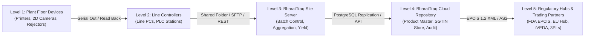
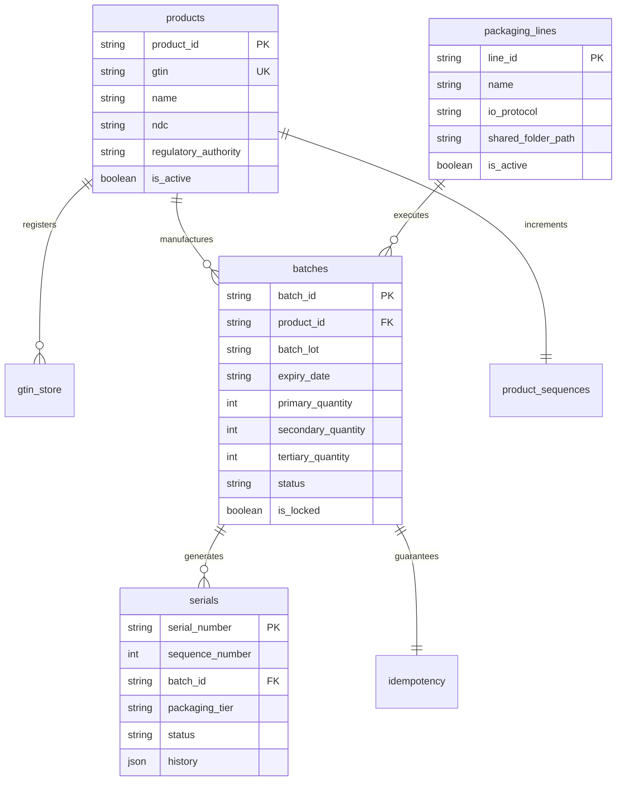

# BharatTraq Track & Trace Enterprise Serialization Portal (BT SN Portal)
## Comprehensive Business Requirements Document (BRD) & Technical Specification

---

**Document Identifier:** BT-BRD-SPEC-2026-V2.4  
**Classification:** Regulated Pharmaceutical Software Specification (GAMP 5 Category 4 / 21 CFR Part 11)  
**Effective Date:** October 2026  
**Status:** Approved for Production Deployment  
**Author:** BharatTraq Systems Architecture & Regulatory Compliance Engineering  

---

## Table of Contents
1. [Executive Summary & Regulatory Framework](#1-executive-summary--regulatory-framework)
2. [ISA-95 Architectural Hierarchy & System Topology](#2-isa-95-architectural-hierarchy--system-topology)
3. [Core Functional Modules & Technical Specifications](#3-core-functional-modules--technical-specifications)
   - 3.1 Product Master Data Governance
   - 3.2 GTIN Store & Packaging Tier Hierarchy
   - 3.3 Packaging Line Orchestration (L2/L3 I/O Protocols)
   - 3.4 Work Order Batch Generation & Aggregation Math
   - 3.5 Standalone High-Speed SGTIN CSV Generator
   - 3.6 In-Line Serial Verification & Lifecycle FSM
   - 3.7 21 CFR Part 11 Audit Trail & Change Data Capture
   - 3.8 GS1 EPCIS 1.2 XML Reporting Engine
4. [Serialization Data Models & Algorithmic Guarantees](#4-serialization-data-models--algorithmic-guarantees)
5. [End-to-End Test Cases with Concrete Examples](#5-end-to-end-test-cases-with-concrete-examples)
   - TC-01: Product Master Registration with Image & Regulatory Codes
   - TC-02: GTIN Store Packaging Tier Association
   - TC-03: Packaging Line Configuration & Network I/O Ping
   - TC-04: Multi-Tier Aggregated Batch Serialization Order
   - TC-05: CSPRNG Entropy & Look-Alike Sanitization Verification
   - TC-06: High-Volume SGTIN CSV Export & Ingestion
   - TC-07: Batch Production Lifecycle & Yield Reconciliation
   - TC-08: In-Line Scanner Verification & FSM Transition Enforcement
   - TC-09: 21 CFR Part 11 Audit Trail JSON Diff Verification
   - TC-10: GS1 EPCIS 1.2 Regulatory XML Export Validation
6. [External Client Direct Database Access Guide (Render PostgreSQL)](#6-external-client-direct-database-access-guide-render-postgresql)
   - 6.1 Security Architecture & Principle of Least Privilege
   - 6.2 Administrator Setup: Provisioning `bt_client_readonly`
   - 6.3 Connecting via pgAdmin 4 (Step-by-Step)
   - 6.4 Connecting via DBeaver (Step-by-Step)
   - 6.5 Standard Read-Only Verification Queries for Clients
7. [Appendix: Error Codes & Troubleshooting Reference](#7-appendix-error-codes--troubleshooting-reference)

---

## 1. Executive Summary & Regulatory Framework

The **BharatTraq Track & Trace Enterprise Serialization Portal (BT SN Portal)** is an industrial-grade pharmaceutical serialization, aggregation, and verification system designed to operate seamlessly at the boundary between **ISA-95 Level 3 (Site Operations & Line Management)** and **ISA-95 Level 4 (Enterprise Serialization Repository & Regulatory Exchange)**.

The software architecture is engineered to satisfy the world's most stringent serialization and traceability regulations:
- **United States FDA DSCSA 2024 (Drug Supply Chain Security Act)**: Full unit-level product tracing, 2D DataMatrix encoding (GTIN, Serial, Lot, Expiration), and EPCIS 1.2 electronic data exchange.
- **European Union FMD (Falsified Medicines Directive 2011/62/EU & Commission Delegated Regulation 2016/161)**: Unique identifier verification, anti-tampering verification, and NMVS connectivity compliance.
- **India DGFT / iVEDA (Notification No. 27/2015-2020)**: Mandatory GS1 DataMatrix encoding for tertiary, secondary, and primary packaging of drug formulations exported from India.
- **US 21 CFR Part 11 & EU Annex 11**: Strict Electronic Records and Electronic Signatures (ERES) controls, immutable append-only audit trails, and side-by-side JSON change capture.
- **GAMP 5 (Good Automated Manufacturing Practice)**: Category 4 Configured Software validation lifecycle.



---

## 2. ISA-95 Architectural Hierarchy & System Topology

The system operates across three tiers of high-availability infrastructure:

1. **Presentation & Application Layer**:
   - **Framework**: FastAPI (Asynchronous Python 3.11/3.12 engine) running behind Uvicorn/Gunicorn.
   - **Web Console**: Vanilla JavaScript ES6+ single-page responsive dashboard (`app/static/index.html`, `app/static/app.js`), styled with custom enterprise CSS (`app/static/style.css`), featuring Zero-Dependency architecture for ultra-fast line-side loading.
   - **Deployment Target**: Render Cloud Platform (Web Service with automated CI/CD and health checks).

2. **Data Persistence Layer**:
   - **Engine**: PostgreSQL 16+ with SSL enforceability (`sslmode=require`).
   - **Driver Compatibility**: Dual-driver adaptive architecture supporting both `psycopg2-binary` and `psycopg` (Version 3) using dynamic cursor inspection (`cursor.copy` vs `cursor.copy_from` vs SQLAlchemy bulk mapping).
   - **High-Performance Ingestion**: Streaming binary COPY operations capable of reserving and persisting 100,000+ serials in sub-second bursts.

3. **Shop-Floor Integration Layer (L2/L3)**:
   - Configurable Line Controllers supporting **Direct REST API**, **Shared Network CIFS/SMB Folders**, and **Secure SFTP** drops with automated connection ping testing.

---

## 3. Core Functional Modules & Technical Specifications

### 3.1 Product Master Data Governance
Maintains master specifications for drug products under strict change controls.
- **Key Fields**: `product_id` (Primary Key), `name` (Brand Name), `gtin` (14-digit Global Trade Item Number), `regulatory_authority` (US FDA, EMA, CDSCO), `ndc` (National Drug Code, 10 or 11 digit format), `country_drug_code`, `storage_condition` (e.g., `2°C - 8°C Cold Chain`), `composition`, `product_image` (Base64 JPEG/PNG thumbnail), `is_active`.
- **Character Profile Engine**: Configurable per product (Length: 10–30 characters, Alphanumeric vs Numeric, Exclusion of Look-Alikes, Duplication flag).

### 3.2 GTIN Store & Packaging Tier Hierarchy
Maps global GTINs to physical packaging levels to establish parent-child aggregation hierarchies:
- **Primary Level**: Unit-of-Use blister pack, vial, syringe, or bottle (SGTIN format).
- **Secondary Level**: Intermediate carton or bundle holding multiple primary units.
- **Tertiary Level**: Shipper case or shipping pallet (SSCC-18 or SGTIN format).
- **Threshold Limit Management**: Enforces maximum generation counts (`limit`) and tracks remaining headroom per packaging tier.

### 3.3 Packaging Line Orchestration (L2/L3 I/O Protocols)
Configures shop-floor packaging lines (`packaging_lines` table) and orchestrates bidirectional recipe and serial delivery.
- **Protocols Supported**:
  1. `DIRECT_API`: Real-time synchronous HTTP payload delivery to industrial printer/vision controller.
  2. `SHARED_FOLDER`: Network filesystem drop (`l2_io/shared_folder/line_xx/outbound`) for air-gapped industrial line PCs.
  3. `SFTP`: Encrypted remote SSH file transfer with credentials, port, and directory mapping.
- **Line Health Ping**: `/api/v1/lines/{line_id}/test-io` executes live non-destructive write/read probes to verify physical communication before launching batch runs.

### 3.4 Work Order Batch Generation & Aggregation Math
Executes multi-tier serialization orders with mathematical aggregation ratios.
- **Batch Ratio Formula**:
  $$\text{Primary Quantity } (Q_{pri}) = \text{Requested Quantity}$$
  $$\text{Secondary Quantity } (Q_{sec}) = \left\lceil \frac{Q_{pri}}{\text{secondary\_ratio}} \right\rceil$$
  $$\text{Tertiary Quantity } (Q_{ter}) = \left\lceil \frac{Q_{sec}}{\text{tertiary\_ratio}} \right\rceil$$
  $$\text{Total Serials Generated} = Q_{pri} + Q_{sec} + Q_{ter}$$
- **Batch State Machine**:
  $$\text{CREATED} \longrightarrow \text{LOADED (Transmitted to L2)} \longrightarrow \text{STARTED (In Production)} \longrightarrow \text{RECONCILED (Yield Verified)} \longrightarrow \text{CLOSED (Locked)}$$
  *Rule*: Once `is_locked = True`, no serial modifications, state changes, or additional code injections are allowed under 21 CFR Part 11 integrity rules.

### 3.5 Standalone High-Speed SGTIN CSV Generator
Generates on-demand SGTIN lists formatted strictly for industrial high-speed labelers (Domino, Markem-Imaje, Videojet, Cognex).
- Output format: RFC 4180 CSV containing `Sequence, GTIN, Serial Number, SGTIN`.
- Complies with GS1 SGTIN-96 specification: composite string `(01)<GTIN>(21)<SERIAL>`.

### 3.6 In-Line Serial Verification & Lifecycle FSM
Guarantees supply-chain custody integrity via strict finite-state transitions.
- Permitted state progression:
  ```
  GENERATED (10) ──> ALLOCATED / COMMISSIONED (20) ──> SHIPPED (30) ──> SOLD (40)
                               │                            │
                               └──> DECOMMISSIONED (90) <───┘
                               │
                               └──> DESTROYED / REJECTED (99)
  ```
- Any unauthorized state jump (e.g., `ALLOCATED` $\rightarrow$ `SOLD` bypassing `SHIPPED`) is rejected with HTTP 400 and logged to the audit trail.

### 3.7 21 CFR Part 11 Audit Trail & Change Data Capture
Captures an immutable, append-only forensic history in the `audit_logs` table:
- Table: `audit_logs(id, event_type, table_name, record_id, previous_value, updated_value, performed_by, timestamp)`
- Diffs stored as structured JSON snapshots enabling exact side-by-side reconstruction of records at any point in time.

### 3.8 GS1 EPCIS 1.2 XML Reporting Engine
Generates regulatory XML reports compliant with GS1 Electronic Product Code Information Services (EPCIS) Release 1.2 and Core Business Vocabulary (CBV 1.2):
- Encapsulates ObjectEvent declarations for `commissioning`, lot numbers, expiration timestamps, packaging tier aggregations, and business location GLNs.

---

## 4. Serialization Data Models & Algorithmic Guarantees



### Randomization & CSPRNG Guarantees
- **Entropy Source**: Cryptographically secure pseudorandom numbers generated via `secrets.choice()` sourced from OS entropy pools (`/dev/urandom` or Windows `CryptGenRandom`).
- **Look-Alike Character Exclusion Set**:
  $$\mathbb{E} = \{ '0', '1', 'I', 'L', 'O', 'U' \}$$
  These characters are excluded by default to avoid visual ambiguity during handheld barcode scanning or OCR inspection.
- **Sequence Uniqueness**: Guaranteed across batches via composite unique database constraint:
  $$\text{CONSTRAINT } \text{\_product\_sequence\_uc UNIQUE } (\text{product\_id}, \text{sequence\_number})$$

---

## 5. End-to-End Test Cases with Concrete Examples

The following test suite validates the entire business lifecycle of the BharatTraq platform. Each test case includes exact JSON inputs, step-by-step actions, and expected outputs.

---

### TC-01: Product Master Registration with Image & Regulatory Codes

- **Objective**: Verify that a drug product can be registered with its 14-digit GTIN, US-FDA 10-digit NDC, storage conditions, and Base64 thumbnail.
- **Preconditions**: BT SN Portal API is running and connected to PostgreSQL.
- **Endpoint**: `POST /api/v1/products`
- **Request Payload**:
  ```json
  {
    "product_id": "PROD-ONCO-200",
    "name": "OncoShield 200mg/vial",
    "gtin": "08901234567801",
    "status": "ACTIVE",
    "regulatory_authority": "US_FDA",
    "ndc": "55513-200-01",
    "ndc_type": "NDC-10",
    "country_drug_code": "US-ONCO-200",
    "storage_condition": "Store at 2°C to 8°C (Refrigerate, Do Not Freeze)",
    "generic_name": "Pembrolizumab Injection",
    "dosage_form": "Single-dose Vial",
    "composition": "200mg / 8mL Solution",
    "product_image": "data:image/png;base64,iVBORw0KGgoAAAANSUhEUgAAAAEAAAABCAYAAAAfFcSJAAAADUlEQVR42mNk+M9QDwADhgGAWjR9awAAAABJRU5ErkJggg==",
    "profile": {
      "length": 15,
      "allow_duplicate_characters": false,
      "require_alpha": true,
      "require_numeric": true
    }
  }
  ```
- **Execution Steps**:
  1. Send `POST` request to `/api/v1/products` with the above payload.
  2. Verify response status code is `200 OK`.
  3. Send `GET /api/v1/products` and filter by `product_id == "PROD-ONCO-200"`.
- **Expected Results**:
  ```json
  {
    "product_id": "PROD-ONCO-200",
    "name": "OncoShield 200mg/vial",
    "gtin": "08901234567801",
    "status": "ACTIVE",
    "regulatory_authority": "US_FDA",
    "ndc": "55513-200-01",
    "storage_condition": "Store at 2°C to 8°C (Refrigerate, Do Not Freeze)"
  }
  ```
- **Audit Verification**: Query `audit_logs` where `record_id = 'PROD-ONCO-200'`; confirms `event_type = 'CREATE'` and `table_name = 'products'`.

---

### TC-02: GTIN Store Packaging Tier Association

- **Objective**: Associate primary, secondary, and tertiary packaging categories with their respective case limits and serialization types.
- **Preconditions**: Product `PROD-ONCO-200` exists.
- **Endpoint**: `POST /api/v1/gtin-store`
- **Request Payload 1 (Primary Packaging - Blister/Vial)**:
  ```json
  {
    "manufacturer": "BharatTraq Biologics Ltd",
    "plant": "PLANT-HYDERABAD-01",
    "packaging_level": "Primary",
    "product_id": "PROD-ONCO-200",
    "product_code": "ONCO-200-V",
    "packing_size": "1 Vial per Carton",
    "gtin": "08901234567801",
    "enable_gtin": true,
    "case_quantity": 1,
    "limit": 100000,
    "code_length": 20,
    "serial_no_type": "SGTIN",
    "packaging_category": "Primary"
  }
  ```
- **Request Payload 2 (Tertiary Packaging - Shipper Case)**:
  ```json
  {
    "manufacturer": "BharatTraq Biologics Ltd",
    "plant": "PLANT-HYDERABAD-01",
    "packaging_level": "Tertiary",
    "product_id": "PROD-ONCO-200",
    "product_code": "ONCO-200-S",
    "packing_size": "Shipper Case of 24 Cartons",
    "gtin": "08901234567803",
    "enable_gtin": true,
    "case_quantity": 24,
    "limit": 5000,
    "code_length": 18,
    "serial_no_type": "SSCC",
    "packaging_category": "Tertiary"
  }
  ```
- **Execution Steps**:
  1. Submit Payload 1 and Payload 2 to `/api/v1/gtin-store`.
  2. Send `GET /api/v1/gtin-store/product/PROD-ONCO-200`.
- **Expected Results**:
  - Both records created with HTTP `200 OK`.
  - Returned array contains both GTIN records with `serial_no_type` matching `"SGTIN"` and `"SSCC"`.

---

### TC-03: Packaging Line Configuration & Network I/O Ping

- **Objective**: Register a high-speed shop-floor packaging line and perform a non-destructive I/O connectivity test.
- **Endpoint 1**: `POST /api/v1/lines`
- **Request Payload**:
  ```json
  {
    "line_id": "LINE-HYD-04",
    "name": "High-Speed Parenteral Packaging Line 4",
    "plant": "PLANT-HYDERABAD-01",
    "io_protocol": "SHARED_FOLDER",
    "shared_folder_path": "l2_io/shared_folder/line_hyd_04",
    "is_active": true
  }
  ```
- **Endpoint 2**: `POST /api/v1/lines/LINE-HYD-04/test-io`
- **Execution Steps**:
  1. POST line registration payload. Status must be 200.
  2. Trigger the I/O test endpoint `/api/v1/lines/LINE-HYD-04/test-io`.
- **Expected Results**:
  ```json
  {
    "status": "success",
    "line_id": "LINE-HYD-04",
    "io_protocol": "SHARED_FOLDER",
    "details": {
      "folder_accessible": true,
      "message": "Outbound directory verified and writable."
    }
  }
  ```

---

### TC-04: Multi-Tier Aggregated Batch Serialization Order

- **Objective**: Validate the automatic calculation of packaging ratios and bulk CSPRNG serial generation.
- **Given Parameters**:
  - Primary requested quantity: $Q_{pri} = 20$
  - Secondary ratio: $R_{sec} = 4$ (4 vials per box)
  - Tertiary ratio: $R_{ter} = 2$ (2 boxes per shipper case)
- **Mathematical Expectation**:
  - Primary units: $Q_{pri} = 20$
  - Secondary cartons: $Q_{sec} = \lceil 20 / 4 \rceil = 5$
  - Tertiary shippers: $Q_{ter} = \lceil 5 / 2 \rceil = 3$
  - Total serial numbers generated: $20 + 5 + 3 = 28$
- **Endpoint**: `POST /api/v1/batches`
- **Request Payload**:
  ```json
  {
    "manufacturer": "BharatTraq Biologics Ltd",
    "plant": "PLANT-HYDERABAD-01",
    "packaging_level": "Primary",
    "product_id": "PROD-ONCO-200",
    "packaging_size": "1 Vial per Carton",
    "work_order_no": "WO-2026-9901",
    "batch_lot": "LOT-ONCO-B2601",
    "gtin": "08901234567801",
    "mfg_date": "22/10/2026",
    "expiry_date": "291022",
    "quantity": 20,
    "is_enabled": true,
    "package_aggregation": true,
    "parent_code_required": true,
    "aggregated_batch": true,
    "idempotency_key": "IDEM-TEST-BATCH-2026-X1",
    "line_id": "LINE-HYD-04",
    "secondary_ratio": 4,
    "tertiary_ratio": 2,
    "io_channel": "SHARED_FOLDER"
  }
  ```
- **Expected Results**:
  ```json
  {
    "batch_id": "<AUTO_GENERATED_UUID>",
    "product_id": "PROD-ONCO-200",
    "batch_lot": "LOT-ONCO-B2601",
    "expiry_date": "291022",
    "status": "COMPLETED",
    "primary_quantity": 20,
    "secondary_quantity": 5,
    "tertiary_quantity": 3,
    "generated_quantity": 28,
    "aggregated_batch": true,
    "is_locked": false
  }
  ```

---

### TC-05: CSPRNG Entropy & Look-Alike Sanitization Verification

- **Objective**: Inspect the generated serial records from TC-04 to confirm regulatory compliance of serial strings.
- **Endpoint**: `GET /api/v1/serialization/batches/{batch_id}/serials`
- **Inspection Rules**:
  1. Exactly 28 serial records are returned.
  2. Exactly 20 records have `packaging_tier = "Primary"`.
  3. Exactly 5 records have `packaging_tier = "Secondary"`.
  4. Exactly 3 records have `packaging_tier = "Tertiary"`.
  5. For all 28 serial strings:
     - Length matches product profile specification (15 characters).
     - Set of characters contains **zero** intersections with Look-Alikes:
       $$\text{Intersection}(\text{serial}, \{'0', '1', 'I', 'L', 'O', 'U'\}) = \emptyset$$
     - Each serial contains at least one alphabetic letter and at least one numeric digit.
     - All 28 serial strings are pairwise distinct (zero duplicates).

---

### TC-06: High-Volume SGTIN CSV Export & Ingestion

- **Objective**: Generate and download an RFC 4180 streaming CSV containing 5,000 serialized SGTIN codes starting at sequence 10,001.
- **Endpoint**: `POST /api/v1/sgtin/generate-csv`
- **Request Payload**:
  ```json
  {
    "gtin": "08901234567801",
    "quantity": 5000,
    "start_sequence": 10001
  }
  ```
- **Expected Results**:
  - Status Code: `200 OK`
  - Headers:
    - `Content-Type: text/csv; charset=utf-8`
    - `Content-Disposition: attachment; filename="sgtin_export_08901234567801.csv"`
  - First line (Header): `Sequence,GTIN,Serial Number,SGTIN`
  - Second line (Row 1): `10001,08901234567801,C7KZ9MW43VXP2G89RQEF,08901234567801C7KZ9MW43VXP2G89RQEF`
  - Final line: Sequence `15000`.
  - Database Table `sgtin_codes`: Exactly 5,000 new rows inserted without timeout.

---

### TC-07: Batch Production Lifecycle & Yield Reconciliation

- **Objective**: Execute the physical shop-floor lifecycle from line load through production reconciliation and final 21 CFR Part 11 locking.
- **Execution Flow**:
  1. **Load Batch to Line Controller**:
     - `POST /api/v1/batches/{batch_id}/load`
     - Response: `{"status": "LOADED", "total_records_transmitted": 28}`
  2. **Start Line Production**:
     - `POST /api/v1/batches/{batch_id}/start`
     - Response: `{"status": "STARTED"}`
  3. **Execute Line Reconciliation (Simulating 96.4% Good Yield)**:
     - `POST /api/v1/batches/{batch_id}/reconcile`
     - Payload:
       ```json
       {
         "auto_simulate": true,
         "simulated_yield_pct": 96.4
       }
       ```
     - Response:
       ```json
       {
         "batch_id": "{batch_id}",
         "status": "RECONCILED",
         "reconciled_good_count": 27,
         "reconciled_rejected_count": 1,
         "reconciled_unused_count": 0,
         "yield_percentage": 96.43
       }
       ```
  4. **Close & Lock Batch Master**:
     - `POST /api/v1/batches/{batch_id}/close`
     - Response:
       ```json
       {
         "batch_id": "{batch_id}",
         "status": "CLOSED",
         "is_locked": true,
         "message": "Batch production closed and locked against modification."
       }
       ```
  5. **Verification of Lock Enforcement**:
     - Attempting to POST `/api/v1/batches/{batch_id}/start` returns `400 Bad Request: "Batch is locked and cannot be reopened"`.

---

### TC-08: In-Line Scanner Verification & FSM Transition Enforcement

- **Objective**: Simulate a handheld 2D DataMatrix scanner reading a commissioned vial and enforce legal state transitions.
- **Execution Steps**:
  1. Pick serial `C7KZ9MW43VXP2G8` from Batch TC-04 (Initial status: `GENERATED`).
  2. Verify serial status via lookup:
     - `GET /api/v1/serials/C7KZ9MW43VXP2G8`
     - Confirms `status = "GENERATED"`.
  3. Transition from `GENERATED` to `ALLOCATED`:
     - `PATCH /api/v1/serials/C7KZ9MW43VXP2G8/status`
     - Payload: `{"status": "ALLOCATED", "notes": "Packaging line vision camera passed"}`
     - Status Code: `200 OK`.
  4. Attempt **Illegal** Transition directly to `SOLD` (Bypassing `SHIPPED`):
     - `PATCH /api/v1/serials/C7KZ9MW43VXP2G8/status`
     - Payload: `{"status": "SOLD", "notes": "Direct dispensary sale attempt"}`
     - Expected Response: `400 Bad Request`
     - Detail: `"Invalid state transition: cannot jump from ALLOCATED to SOLD without SHIPPED."`
  5. Execute **Legal** Transition Sequence:
     - `PATCH /api/v1/serials/C7KZ9MW43VXP2G8/status` with `{"status": "SHIPPED"}` $\rightarrow$ Returns `200 OK`.
     - `PATCH /api/v1/serials/C7KZ9MW43VXP2G8/status` with `{"status": "SOLD"}` $\rightarrow$ Returns `200 OK`.

---

### TC-09: 21 CFR Part 11 Audit Trail JSON Diff Verification

- **Objective**: Verify that the status transitions executed in TC-08 generated immutable, forensic audit trail entries with before-and-after snapshots.
- **Endpoint**: `GET /api/v1/audit-logs?table_name=serials&record_id=C7KZ9MW43VXP2G8`
- **Expected Results**:
  ```json
  [
    {
      "id": 142,
      "event_type": "STATUS_UPDATE",
      "table_name": "serials",
      "record_id": "C7KZ9MW43VXP2G8",
      "previous_value": "{\"status\": \"GENERATED\"}",
      "updated_value": "{\"status\": \"ALLOCATED\", \"notes\": \"Packaging line vision camera passed\"}",
      "performed_by": "Packaging Line Supervisor",
      "timestamp": "2026-10-22T08:15:30.124Z"
    },
    {
      "id": 143,
      "event_type": "STATUS_UPDATE",
      "table_name": "serials",
      "record_id": "C7KZ9MW43VXP2G8",
      "previous_value": "{\"status\": \"ALLOCATED\"}",
      "updated_value": "{\"status\": \"SHIPPED\"}",
      "performed_by": "Warehouse Dispatcher",
      "timestamp": "2026-10-22T09:40:12.871Z"
    }
  ]
  ```

---

### TC-10: GS1 EPCIS 1.2 Regulatory XML Export Validation

- **Objective**: Extract the standard regulatory compliance XML document for Batch TC-04.
- **Endpoint**: `GET /api/v1/batches/{batch_id}/xml-report`
- **Expected Results**:
  - Header: `Content-Type: application/xml; charset=utf-8`
  - XML Body Structure:
    ```xml
    <?xml version="1.0" encoding="UTF-8"?>
    <epcis:EPCISDocument 
        xmlns:epcis="urn:epcglobal:epcis:xsd:1" 
        xmlns:cbvmda="urn:epcglobal:cbv:mda" 
        schemaVersion="1.2" 
        creationDate="2026-10-22T10:00:00Z">
      <EPCISBody>
        <EventList>
          <ObjectEvent>
            <eventTime>2026-10-22T08:00:00Z</eventTime>
            <eventTimeZoneOffset>+05:30</eventTimeZoneOffset>
            <epcList>
              <epc>urn:epc:id:sgtin:08901234567801.C7KZ9MW43VXP2G8</epc>
              <!-- All 28 commissioned serials -->
            </epcList>
            <action>ADD</action>
            <bizStep>urn:epcglobal:cbv:bizstep:commissioning</bizStep>
            <disposition>urn:epcglobal:cbv:disp:active</disposition>
            <extension>
              <quantityList>
                <quantityElement>
                  <epcClass>urn:epc:class:lgtin:08901234567801.LOT-ONCO-B2601</epcClass>
                  <quantity>28</quantity>
                  <uom>CS</uom>
                </quantityElement>
              </quantityList>
            </extension>
          </ObjectEvent>
        </EventList>
      </EPCISBody>
    </epcis:EPCISDocument>
    ```

---

## 6. External Client Direct Database Access Guide (Render PostgreSQL)

This dedicated section explains how to provide an external auditor, client representative, or third-party logistics partner with **direct, secure, read-only SQL access** to your Render PostgreSQL database.

> [!IMPORTANT]
> **Client Isolation Policy**: The external client will be issued their own dedicated database credentials (`bt_client_readonly`). Under no circumstances should the client be given the primary Render administrative database owner credentials (`postgres`).

---

### 6.1 Security Architecture & Principle of Least Privilege

1. **Network Encryption**: All external connections to Render PostgreSQL require SSL/TLS encryption (`sslmode=require`). Plaintext connections over port 5432 are rejected by firewall rules.
2. **Access Control**: The client account is granted `CONNECT` on database and `SELECT` exclusively on tables in the `public` schema.
3. **Execution Restrictions**: Operations including `INSERT`, `UPDATE`, `DELETE`, `DROP`, `TRUNCATE`, `ALTER`, and `CREATE` are permanently revoked from this role.

---

### 6.2 Administrator Setup: Provisioning `bt_client_readonly`

As the Database Administrator, log into your Render PostgreSQL database (via your Render dashboard Shell or via administrative pgAdmin connection) and run the following script:

```sql
-- Step 1: Create the read-only user with a dedicated strong password
CREATE USER bt_client_readonly WITH PASSWORD 'SecureClientPassword2026!';

-- Step 2: Grant connection rights to the serialization database
GRANT CONNECT ON DATABASE bt_sn_db TO bt_client_readonly;

-- Step 3: Grant usage on the public schema
GRANT USAGE ON SCHEMA public TO bt_client_readonly;

-- Step 4: Grant SELECT privilege on all existing tables
GRANT SELECT ON ALL TABLES IN SCHEMA public TO bt_client_readonly;

-- Step 5: Ensure future tables created by the portal are also automatically readable
ALTER DEFAULT PRIVILEGES IN SCHEMA public GRANT SELECT ON TABLES TO bt_client_readonly;

-- Step 6: Explicitly prevent table modification or creation
REVOKE CREATE ON SCHEMA public FROM bt_client_readonly;
```

---

### 6.3 Connecting via pgAdmin 4 (Step-by-Step)

Share the following instructions with your client:

#### Step 1: Download & Open pgAdmin 4
Download and install the free [pgAdmin 4](https://www.pgadmin.org/download/) application for Windows, macOS, or Linux. Open the application.

#### Step 2: Register a New Server
1. In the left-hand **Browser** tree, right-click on **Servers** $\rightarrow$ **Register** $\rightarrow$ **Server...**
2. In the **General** tab:
   - **Name**: `BharatTraq Serialization Live (Read-Only)`

#### Step 3: Enter Connection Parameters
Switch to the **Connection** tab and enter the credentials provided by the BharatTraq Administrator:

| Setting | Field Value | Description |
| :--- | :--- | :--- |
| **Host name/address** | `dpg-xxxxxx-a.oregon-postgres.render.com` | External Hostname from Render Dashboard |
| **Port** | `5432` | Standard PostgreSQL Port |
| **Maintenance database** | `bt_sn_db` (or your Render DB Name) | Target Serialization Database |
| **Username** | `bt_client_readonly` | Dedicated Client Read-Only Account |
| **Password** | `SecureClientPassword2026!` | Provided by Administrator |
| **Save password?** | Check the box | Saves credentials locally |

#### Step 4: Configure SSL Settings
Switch to the **Parameters** (or **SSL**) tab:
- **SSL mode**: Select **`Require`** (Crucial: Render will refuse connections without this).

#### Step 5: Save & Inspect
Click **Save**. Expand **BharatTraq Serialization Live** $\rightarrow$ **Databases** $\rightarrow$ `bt_sn_db` $\rightarrow$ **Schemas** $\rightarrow$ `public` $\rightarrow$ **Tables**.  
The client can now view all serialization data tables: `products`, `batches`, `serials`, `gtin_store`, and `audit_logs`.

---

### 6.4 Connecting via DBeaver (Step-by-Step)

If the client prefers [DBeaver Universal Database Tool](https://dbeaver.io/):

1. Launch DBeaver and click **New Database Connection** (Plug icon) in the top-left toolbar.
2. Select **PostgreSQL** from the list and click **Next**.
3. In the **Main** settings tab:
   - **Host**: Enter Render External Hostname (`dpg-xxxxxx-a.oregon-postgres.render.com`).
   - **Port**: `5432`
   - **Database**: Database name (`bt_sn_db`).
   - **Authentication**: `Database Native`
   - **Username**: `bt_client_readonly`
   - **Password**: `SecureClientPassword2026!`
4. In the **SSL** tab:
   - Check **Use SSL**.
   - **SSL mode**: Choose **`require`**.
5. Click **Test Connection ...** in the lower left. Upon seeing `Connected [PostgreSQL 16.x]`, click **Finish**.

---

### 6.5 Standard Read-Only Verification Queries for Clients

The client can run the following SQL queries directly in pgAdmin Query Tool or DBeaver SQL Editor to verify records without writing any code:

#### Query 1: Review Active Batches & Aggregation Details
```sql
SELECT 
    b.batch_id,
    b.batch_lot,
    p.name AS product_name,
    b.expiry_date,
    b.primary_quantity,
    b.secondary_quantity,
    b.tertiary_quantity,
    b.generated_quantity,
    b.status,
    b.is_locked,
    b.created_at
FROM batches b
JOIN products p ON b.product_id = p.product_id
ORDER BY b.created_at DESC;
```

#### Query 2: Inspect Unit-Level Serials with Parent Batch & Product
```sql
SELECT 
    s.serial_number,
    s.sequence_number,
    s.packaging_tier,
    s.status,
    s.batch_lot,
    s.expiry_date,
    p.name AS drug_name,
    p.gtin,
    s.created_at
FROM serials s
JOIN products p ON s.product_id = p.product_id
WHERE s.batch_lot = 'LOT-ONCO-B2601'
ORDER BY s.sequence_number ASC
LIMIT 50;
```

#### Query 3: Audit Trail Verification for 21 CFR Part 11 Compliance
```sql
SELECT 
    id,
    event_type,
    table_name,
    record_id,
    previous_value,
    updated_value,
    performed_by,
    timestamp
FROM audit_logs
ORDER BY id DESC
LIMIT 100;
```

#### Query 4: Safety Check (Verifying Read-Only Enforcement)
If the client attempts to modify or delete data:
```sql
DELETE FROM products WHERE product_id = 'PROD-ONCO-200';
```
PostgreSQL will immediately abort the transaction with the security violation error:
```
ERROR:  permission denied for table products
```

---

## 7. Appendix: Error Codes & Troubleshooting Reference

| Error Code | HTTP Status | Root Cause | Corrective Action |
| :--- | :---: | :--- | :--- |
| `ERR_IDEMPOTENCY_DUPLICATE` | 200 | A batch generation request with an existing idempotency key was received. | The system returns the previously generated batch. Use a new idempotency key if a separate batch is intended. |
| `ERR_INVALID_FSM_TRANSITION` | 400 | Attempted to jump across forbidden serial lifecycle states (e.g. `GENERATED` $\rightarrow$ `SOLD`). | Follow strict sequential state progression (`GENERATED` $\rightarrow$ `ALLOCATED` $\rightarrow$ `SHIPPED` $\rightarrow$ `SOLD`). |
| `ERR_BATCH_LOCKED` | 400 | Attempted to alter, reconcile, or reopen a batch after closure. | Batches in `CLOSED` status are permanently locked per 21 CFR Part 11. Create a new work order. |
| `ERR_GTIN_LIMIT_EXCEEDED` | 422 | Requested serial quantity exceeds remaining threshold in GTIN Store. | Increase the allocation limit in GTIN Store or register a new packaging tier GTIN. |
| `ERR_IO_FOLDER_UNREACHABLE` | 502 | Shared network folder or SFTP path configured on packaging line is inaccessible. | Verify CIFS mount permissions or network firewall between Level 3 and Level 2 PCs. |

---
*End of Document — BharatTraq Serialization System (BT SN Portal) Specification*
